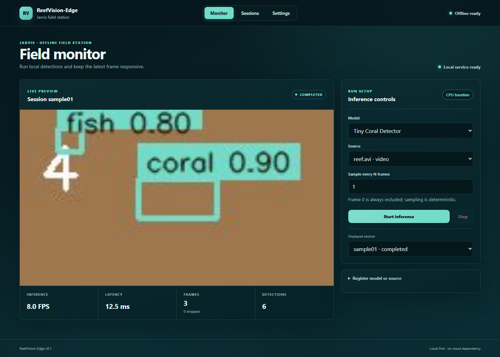

# ReefVision-Edge

ReefVision-Edge v0.1 is a standalone, offline-first field inference service for the Jetson station **Jarvis**. It registers a local ONNX object detector, processes imported video or a Linux UVC/V4L2 camera, renders detection overlays and metrics, persists durable SQLite sessions, and exports versioned JSON/CSV bundles for desktop review.

The Python service and React dashboard are served from one origin. It binds to `127.0.0.1:8765` by default, needs no runtime network access, and keeps its models, media copies, database, and exports independent from desktop ReefVision.



## What v0.1 supports

- Local `.onnx` object detectors with explicit class, input, preprocessing, and output metadata.
- `ultralytics_yolo_detect_v1`: fixed NCHW RGB float32 input, centered letterbox, `[1, 4 + classes, candidates]` output, `xywh` input-pixel boxes, and per-class confidence values.
- ONNX Runtime provider detection with the provider actually used stored in every session/export. CPU is the portable baseline.
- Immutable copies of local AVI, MP4, MOV, M4V, and MKV uploads, subject to the codecs in the installed OpenCV/FFmpeg build.
- Linux V4L2 camera paths such as `/dev/video0`, with a bounded newest-frame queue.
- Deterministic recorded sampling: frame zero and every Nth frame; timestamps use `frame_index / reported_fps` when constant-rate metadata exists.
- Original-frame pixel coordinates through preprocessing, inference, preview, persistence, and export.
- Durable `completed`, `canceled`, `interrupted`, and `failed` sessions, including recovery of stale running jobs after service restart.
- Native `reefvision-edge-session/v1` manifest and detection CSV export. See [the schema](docs/export-schema-v1.md) and [sample export](examples/session-export/manifest.json).

Training, tracking, field-mask editing, direct DJI/Sony controller integrations, and fleet/cloud management are not in v0.1.

## Quick start for development

Requirements: Python 3.11+, Node.js 22+, npm 10+, and Git. All model weights and media remain local.

```powershell
python -m venv .venv
.\.venv\Scripts\python.exe -m pip install -e ".[dev]"
npm --prefix web ci
npm --prefix web run build
.\.venv\Scripts\reefvision-edge.exe
```

Open [http://127.0.0.1:8765](http://127.0.0.1:8765). Linux uses `.venv/bin/python`, `.venv/bin/pip`, and `.venv/bin/reefvision-edge` instead.

The production frontend is built into `src/reefvision_edge/static`; the service serves those assets directly. No frontend development server is needed in the field.

## Register a model

ReefVision desktop commit `e94dad6a3bece7b776bf45776bc5d06cfbc2c0dc` trains and registers Ultralytics checkpoints, but it does not expose a direct ONNX export operation. Export a local ReefVision-trained detection checkpoint with a matching Ultralytics installation:

```bash
yolo export model=/path/to/best.pt format=onnx imgsz=640 opset=17 simplify=False dynamic=False nms=False
```

Then register the resulting `best.onnx` with metadata like:

```json
{
  "name": "Coral detector",
  "format": "ultralytics_yolo_detect_v1",
  "input_width": 640,
  "input_height": 640,
  "classes": { "0": "coral", "1": "fish" },
  "preprocessing": {
    "color_order": "rgb",
    "scale": "0_1",
    "letterbox": "centered"
  },
  "output": {
    "layout": "1x(4+classes)xN",
    "box_format": "xywh",
    "score_format": "class_probabilities"
  },
  "confidence_threshold": 0.5,
  "iou_threshold": 0.45
}
```

Edge validates the input/output tensors with a dry run and records SHA-256 hashes for both files. It clearly rejects PyTorch checkpoints, dynamic inputs, mismatched class maps, objectness-bearing outputs, and post-NMS exports. The included deterministic test model exercises this exact path without downloading weights.

## Field operation

1. Open **Monitor** and expand **Register model or source**.
2. Register the ONNX file plus metadata JSON.
3. Import recorded footage or connect a Linux V4L2 device.
4. Select the model/source, choose the sampling interval, and start inference.
5. Watch boxes, class labels, scores, frame counts, effective FPS, latency, dropped frames, provider, and state.
6. Stop a live job when finished. Open prior runs under **Sessions** and download an export.

Source media supplied to the service is never modified. Uploaded media is copied into managed storage.

## Storage

The default development directory is `./data`; production should set an absolute path with `REEFVISION_EDGE_DATA_DIR`.

```text
data/
├── reefvision-edge.sqlite3
├── models/<model UUID>/model.onnx
├── media/<source UUID>/source.<container>
└── exports/<session UUID>.zip
```

SQLite uses WAL mode. Each processed frame is committed independently so earlier detections survive cancellation, decoder/camera failure, or later write failure.

## Headless Jarvis deployment

Create a dedicated account and storage path using your normal station administration process; this project does not change drivers, firewall rules, JetPack, or system firmware. Copy [deploy/reefvision-edge.service](deploy/reefvision-edge.service) to `/etc/systemd/system/` only after updating `User`, `Group`, `WorkingDirectory`, `EnvironmentFile`, and paths.

Example `/etc/reefvision-edge.env`:

```dotenv
REEFVISION_EDGE_DATA_DIR=/var/lib/reefvision-edge
REEFVISION_EDGE_BIND_HOST=127.0.0.1
REEFVISION_EDGE_BIND_PORT=8765
```

```bash
sudo systemctl daemon-reload
sudo systemctl enable --now reefvision-edge
sudo systemctl status reefvision-edge
journalctl -u reefvision-edge -f
```

From a laptop:

```bash
ssh -N -L 8765:127.0.0.1:8765 jarvis-user@jarvis
```

Then open `http://127.0.0.1:8765`. Loopback remains the recommended mode.

### Explicit LAN mode

Any non-loopback bind refuses startup unless both credentials are set. Authentication covers the dashboard, API, previews, and downloads.

```dotenv
REEFVISION_EDGE_BIND_HOST=0.0.0.0
REEFVISION_EDGE_AUTH_USERNAME=field
REEFVISION_EDGE_AUTH_PASSWORD=replace-with-a-long-secret
```

HTTP Basic authentication does not encrypt traffic. Use a trusted isolated LAN or terminate TLS in an administrator-managed reverse proxy. ReefVision-Edge does not modify firewall rules.

## Offline installation bundle

Run the matching script on the same OS/CPU architecture and Python minor version as the target, because native NumPy, OpenCV, and ONNX Runtime wheels are platform-specific.

```powershell
.\scripts\build_offline_bundle.ps1
```

```bash
./scripts/build_offline_bundle.sh
```

The bundle contains the ReefVision-Edge wheel (including the dashboard), dependency wheels, source archive, and checksums. On the offline target:

```bash
python3 -m venv .venv
.venv/bin/pip install --no-index --find-links wheels app/reefvision_edge-0.1.0-py3-none-any.whl
```

Jetson acceleration wheels are JetPack-specific and are not bundled or claimed by the Windows verification run. Install a compatible NVIDIA ONNX Runtime/TensorRT provider separately, then confirm `/api/capabilities` and the provider shown in the session.

## Verification

```powershell
.\.venv\Scripts\python.exe -m ruff check .
.\.venv\Scripts\python.exe -m mypy src
.\.venv\Scripts\python.exe -m pytest -q
npm --prefix web run format:check
npm --prefix web test
npm --prefix web run typecheck
npm --prefix web run build
npm --prefix web run test:e2e
```

The detailed host/runtime results and explicit hardware gaps are in [docs/verification-report.md](docs/verification-report.md).

## Theme provenance and screenshots

The dashboard theme is based on ReefVision `main` commit `e94dad6a3bece7b776bf45776bc5d06cfbc2c0dc`, specifically `apps/web/src/main.tsx`, `apps/web/src/App.tsx`, and `apps/web/src/styles/{clarity-overhaul,design-system,app}.css`. Import order and semantic tokens were audited at that commit. Exact local tokens live in `web/src/styles/theme.css`; Playwright asserts representative computed surfaces, text, actions, selection, focus, and status colors.

- [Monitor, laptop](docs/screenshots/monitor-laptop.png) · [compact](docs/screenshots/monitor-compact.png)
- [Sessions, laptop](docs/screenshots/sessions-laptop.png) · [compact](docs/screenshots/sessions-compact.png)
- [Settings, laptop](docs/screenshots/settings-laptop.png) · [compact](docs/screenshots/settings-compact.png)

See [THIRD_PARTY_NOTICES.md](THIRD_PARTY_NOTICES.md) for provenance and licensing.
